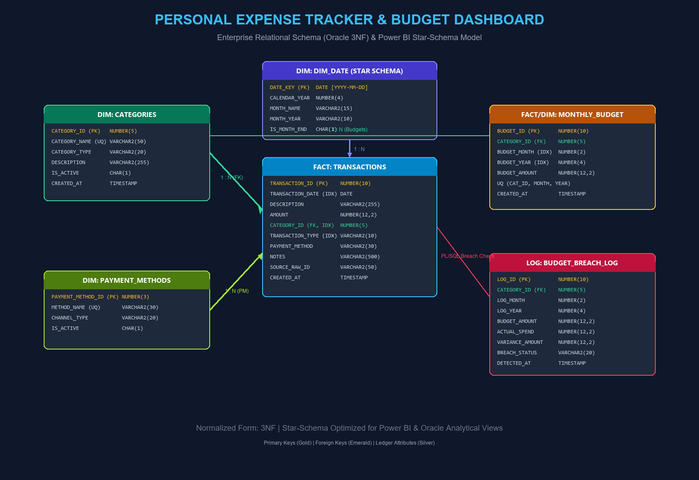

<<<<<<< HEAD
# 💳 Personal Expense Tracker & Budget Dashboard

[](https://python.org)
[](https://streamlit.io)
[](https://oracle.com)
[](https://powerbi.microsoft.com)
[]()
[]()

> **An End-to-End Financial Intelligence & Analytics System** developed as part of the **HCL Data Analyst Training Program**. Demonstrates production-grade data engineering, Oracle 3NF relational design, PL/SQL budget validation, interactive Streamlit fintech UI, and Power BI dimensional modeling.

---

## 📌 Table of Contents
- [1. Executive Summary & Problem Statement](#1-executive-summary--problem-statement)
- [2. System Architecture & Relational Design](#2-system-architecture--relational-design)
- [3. Key Features](#3-key-features)
- [4. Technology Stack](#4-technology-stack)
- [5. Project Folder Structure](#5-project-folder-structure)
- [6. Installation & Execution Guide](#6-installation--execution-guide)
- [7. Oracle SQL & PL/SQL Implementation](#7-oracle-sql--plsql-implementation)
- [8. Power BI Dashboard Suite](#8-power-bi-dashboard-suite)
- [9. Dataset & Data Hygiene Audit](#9-dataset--data-hygiene-audit)
- [10. Test Execution & Quality Attestation](#10-test-execution--quality-attestation)
- [11. Deliverables Checklist](#11-deliverables-checklist)
- [12. Future Roadmap & Enhancements](#12-future-roadmap--enhancements)

---

## 1. Executive Summary & Problem Statement

### The Business Challenge
In modern retail banking, consumers disburse funds across multiple disparate channels—UPI, contactless credit cards, debit cards, net banking, and cash disbursements. This fragmentation causes:
- **Discretionary Overspending**: Lack of real-time visibility into category-level budget ceilings.
- **Delayed Breach Detection**: Overruns are typically detected only after month-end statements arrive.
- **Accounting Distortions**: Merchant refunds and reimbursements are frequently misclassified as primary income or positive expenses.
- **Data Hygiene Failures**: Raw CSV bank statements regularly exhibit duplicate entries, null dates, corrupted amounts, and ambiguous merchant strings.

### The Solution
The **Personal Expense Tracker and Budget Dashboard** addresses these challenges via a 4-tier enterprise analytics architecture:
1. **Python Data Pipeline**: Automates data ingestion, sanitization, duplicate quarantine, refund isolation, and keyword-based categorization with zero silent discards.
2. **Oracle SQL & PL/SQL Engine**: Provides a normalized 3NF relational schema, enforcing integrity constraints and running an autonomous PL/SQL package (`PKG_BUDGET_MANAGEMENT`) for breach evaluation.
3. **Streamlit Fintech Web Application**: Delivers operational transaction CRUD capabilities, dynamic category budget adjustments, and executive KPI cards.
4. **Power BI Analytics Suite**: Offers a 4-page executive business intelligence dashboard leveraging a Kimball Star Schema and custom DAX measures.

---

## 2. System Architecture & Relational Design

The system implements a normalized 3NF Oracle relational model and an analytical Star-Schema:



### Key Relational Entities:
- **`TRANSACTIONS` (Fact Table)**: Ledger of credits, debits, and refunds with foreign key references and check constraints (`AMOUNT > 0`, `TRANSACTION_TYPE IN ('INCOME', 'EXPENSE', 'REFUND')`).
- **`CATEGORIES` (Dimension Table)**: Master financial taxonomy (`Housing`, `Food & Dining`, `Transportation`, `Shopping`, `Utilities`, `Healthcare`, `Entertainment`, `Education`, `Travel`, `Other`, `Uncategorised`).
- **`PAYMENT_METHODS` (Dimension Table)**: Supported payment rails (`UPI`, `Credit Card`, `Debit Card`, `Net Banking`, `Cash`).
- **`MONTHLY_BUDGET` (Budget Fact / Target)**: Configured spending caps per category, month, and year with uniqueness constraints.
- **`BUDGET_BREACH_LOG` (Audit Table)**: Autonomous log written by PL/SQL whenever a category exceeds 100% utilization.
- **`AUDIT_LOG` (Quarantine Table)**: Tracks excluded raw records and validation anomalies.

---

## 3. Key Features

### 📊 A. Executive Dashboard Overview
- Real-time KPI metrics: Monthly Income, Gross Outlays, Refunds Offset, Net Expenses, Net Savings, Savings Rate %, and Budget Utilization %.
- Dynamic alert banners for active budget breaches.
- Interactive Plotly Donut Chart of category spending and Clustered Bar Chart of Budget vs. Actual spend.
- Monthly expenditure trend line with refund reconciliations.

### 💸 B. Operational Expense Management (CRUD)
- **Add Transactions**: Input transaction details with real-time automatic category suggestion.
- **Edit & Delete**: Search and modify any recorded line item with instant persistence.
- **Search & Multi-Filter**: Filter dynamically by date range, category, payment rail, and transaction type.

### 🏷️ C. Automated Categorization & Classifier
- Rule-based keyword mapping for vendor strings (e.g. Swiggy, Uber, Netflix, Amazon, BESCOM).
- **Zero Silent Distortion**: Unrecognized entries strictly default to `Uncategorised`.
- Interactive NLP testing sandbox and manual taxonomy override tool.

### 🎯 D. Budget Governance & PL/SQL Breach Detection
- Set global monthly caps and individual category budgets.
- Automated evaluation of spend thresholds: `ON TRACK` (<85%), `WARNING` (85%-100%), `BREACH` (>100%).
- Server-side Oracle PL/SQL package for automated validation and audit logging.

### 📜 E. Transaction History & Audit
- Chronological date-wise transaction ledger.
- Explicit visual isolation of merchant refunds.
- One-click CSV dataset export.

### 💡 F. Data-Driven Financial Insights
- Dynamically calculated insights: Highest & Lowest spending categories, Savings Rate trajectory, and burn rate.
- Month-over-Month (MoM) growth calculations using analytic window functions.
- Integrated Data Quality and Hygiene Audit report viewer.

---

## 4. Technology Stack

| Technology | Purpose in Project |
|---|---|
| **Python 3.14** | Core programming language, data engineering, and application backend |
| **Pandas & NumPy** | Ingestion, data cleaning, matrix transformations, and aggregations |
| **Streamlit** | Fintech web application interface and interactive dashboard |
| **Plotly** | Interactive high-resolution financial charts and visualization widgets |
| **Oracle SQL** | Enterprise 3NF relational schema, DDL constraints, sequences, and views |
| **Oracle PL/SQL** | Stored procedures, packages, functions, and autonomous breach detection triggers |
| **Power BI Desktop** | 4-Page executive business intelligence dashboard and Star Schema |
| **DAX (Data Analysis Expressions)** | Specialized financial measures, MoM variance walks, and conditional formatting |
| **Pytest** | Automated unit testing for all 8 mandatory validation test cases |
| **Pillow (PIL)** | Programmatic generation of high-resolution schema architecture diagrams |

---

## 5. Project Folder Structure

```
Personal-Expense-Tracker/
│
├── app/
│   ├── main.py                     # Streamlit web application entry point
│   ├── components/
│   │   └── ui_helpers.py           # Reusable KPI cards & Plotly chart builders
│   └── styles/
│       └── custom.css              # Fintech banking UI stylesheet
│
├── python/
│   ├── data_cleaning.py            # Ingestion, hygiene auditing, and deduplication
│   ├── expense_categorization.py   # Rule-based NLP categorization engine
│   ├── data_validation.py          # Data validation & test assertion helpers
│   ├── analysis.py                 # Financial KPI aggregations, variance, & insights
│   ├── run_pipeline.py             # Main data orchestrator script
│   ├── generate_dataset.py         # Synthetic transaction generator (600+ records)
│   └── generate_diagram.py         # High-resolution schema diagram generator
│
├── data/
│   ├── raw/
│   │   └── sample_expenses_raw.csv # Raw transaction statement (with test anomalies)
│   ├── processed/
│   │   ├── clean_transactions.csv  # Sanitized, categorized transaction fact table
│   │   ├── categories.csv          # Master categories dimension table
│   │   ├── monthly_budget.csv      # Monthly budget allocation targets
│   │   ├── dim_date.csv            # Calendar date dimension table
│   │   └── dim_payment_methods.csv # Payment rails dimension table
│   └── sample_expenses.csv         # Primary clean benchmark dataset
│
├── oracle_sql/
│   ├── 01_create_tables.sql        # DDL: Tables, constraints, sequences, and indexes
│   ├── 02_insert_data.sql          # DML: Batch data insertion scripts
│   ├── 03_queries.sql              # Analytical queries, aggregations, & window functions
│   ├── 04_views.sql                # Production views for monthly & category metrics
│   └── 05_plsql_budget_validation.sql # PL/SQL package, procedures, & triggers
│
├── powerbi/
│   ├── dax_measures.md             # Complete DAX formulas library
│   ├── data_model.md               # Star Schema layout and relationship cardinalities
│   └── dashboard_guide.md          # 4-Page dashboard assembly & visual layout guide
│
├── diagrams/
│   └── database_schema.png         # High-res architecture & Star Schema diagram
│
├── reports/
│   ├── data_quality_report.md      # Data hygiene audit & quarantine log
│   ├── test_cases.md               # Execution report for the 8 mandatory test cases
│   └── insights_summary.md         # Strategic financial analysis summary
│
├── tests/
│   └── test_project.py             # Pytest automated test suite (8 mandatory tests)
│
├── docs/
│   ├── problem_statement.md        # Formal business & technical problem statement
│   ├── kpi_definitions.md          # Mathematical formulas and business definitions
│   ├── project_documentation.md    # Architecture and module responsibilities
│   └── demo_presentation_guide.md  # Video recording script & viva-voce Q&A defense
│
├── requirements.txt                # Python package dependencies
├── .env.example                    # Template for Oracle connection credentials
├── .gitignore                      # Git configuration ignore rules
└── README.md                       # Master project documentation
```

---

## 6. Installation & Execution Guide

### Prerequisites
- Python 3.10 to 3.14 installed on your system.
- Git installed.
- (Optional) Oracle Database 19c / 21c / 23c / XE installed locally or in cloud.
- (Optional) Power BI Desktop installed for viewing `.pbix` dashboards.

### Step 1: Clone or Navigate to the Workspace
```powershell
cd "c:\Users\jaisw\OneDrive\Desktop\hcl project"
```

### Step 2: Set Up Virtual Environment & Dependencies
```powershell
python -m venv venv
.\venv\Scripts\activate
pip install -r requirements.txt
```

### Step 3: Run the Data Pipeline
Executes raw transaction generation, data cleaning, duplicate detection, and exports SQL insert scripts:
```powershell
python -m python.run_pipeline
```

### Step 4: Launch the Streamlit Web Application
```powershell
python -m streamlit run app/main.py
```
*(Alternatively, run `.\run_app.bat` or `streamlit run app/main.py`)*

*Access the local web dashboard at `http://localhost:8501` in your browser.*

### Step 5: Execute Automated Test Suite
Run the 8 mandatory test cases with verbose output:
```powershell
pytest -v tests/test_project.py
```

---

## 7. Oracle SQL & PL/SQL Implementation

All SQL scripts are located in `oracle_sql/` and are fully executable in Oracle SQL Developer, SQL*Plus, or DBeaver:

1. **Table Creation (`01_create_tables.sql`)**: Creates 6 normalized tables (`CATEGORIES`, `PAYMENT_METHODS`, `TRANSACTIONS`, `MONTHLY_BUDGET`, `BUDGET_BREACH_LOG`, `AUDIT_LOG`) with primary keys, foreign keys, and check constraints.
2. **Data Population (`02_insert_data.sql`)**: Populates categories, payment methods, monthly budgets, and over 600 verified transactions.
3. **Analytical Queries (`03_queries.sql`)**: Executes 6 enterprise SQL reports including monthly financial reconciliation, category spend share, budget variance, and Month-over-Month growth using `LAG()`.
4. **Database Views (`04_views.sql`)**: Creates reusable views including `VW_MONTHLY_FINANCIAL_SUMMARY`, `VW_CATEGORY_SPEND_ANALYSIS`, and `VW_BUDGET_UTILIZATION`.
5. **PL/SQL Package (`05_plsql_budget_validation.sql`)**:
   - Implements `PKG_BUDGET_MANAGEMENT`.
   - Function `fn_get_net_spending`: Computes net expenses (Gross - Refunds).
   - Function `fn_check_budget_breach`: Computes variance and returns status (`BREACH`, `WARNING`, `ON_TRACK`).
   - Procedure `pr_validate_monthly_budgets`: Audits all categories for a calendar month.
   - Autonomous procedure `pr_log_breach`: Persists breach events to `BUDGET_BREACH_LOG`.
   - Trigger `TRG_TXN_BUDGET_BREACH_CHECK`: Validates budget impact on new expense inserts.

---

## 8. Power BI Dashboard Suite

A comprehensive 4-page executive business intelligence suite designed for Power BI Desktop:

- **Page 1: Financial Overview**: High-level KPI cards (Income, Expenses, Savings, Savings Rate %, Utilization %), Monthly Cashflow Clustered Column Chart, and Category Donut Chart.
- **Page 2: Expense Analysis**: Donut chart of category distribution, Monthly spending trend line with moving average, and Payment rail horizontal bar chart.
- **Page 3: Budget Monitoring & Governance**: Clustered bar chart of Budget vs Actual Net Spend, Radial Utilization Gauge, and detailed table with dynamic alert badge formatting.
- **Page 4: Financial Insights & Velocity**: Pareto analysis, Month-over-Month expenditure waterfall, and strategic financial recommendations card.

*For complete step-by-step assembly instructions, DAX formulas, and star-schema relationships, refer to [powerbi/dashboard_guide.md](powerbi/dashboard_guide.md), [powerbi/dax_measures.md](powerbi/dax_measures.md), and [powerbi/data_model.md](powerbi/data_model.md).*

---

## 9. Dataset & Data Hygiene Audit

The project features a realistic synthetic dataset (`data/raw/sample_expenses_raw.csv`) of **611 records** spanning Q4 2026 (October – December 2026):
- **Fixed Recurring Inflows**: Monthly salary credits (`₹1,25,000.00`) and consulting revenue (`₹35,000.00`).
- **Fixed Expenses**: Residential rent (`₹22,000.00`) and utilities.
- **Discretionary Outlays**: Food delivery, groceries, fuel, cabs, shopping, entertainment, healthcare, and education.
- **Merchant Refunds**: 12 verified merchant reversals (`₹40,183.00`) properly offsetting gross expenses.
- **Uncategorised Items**: 18 ambiguous merchant tokens preserved under category `Uncategorised`.
- **Month-End Boundary Dates**: 11 transactions on days 28–31 validated for reporting accuracy.
- **Data Hygiene Auditing**: 4 malformed records (null dates, negative amounts, corrupted strings) and 2 duplicate entries intercepted and logged in [reports/data_quality_report.md](reports/data_quality_report.md).

---

## 10. Test Execution & Quality Attestation

The test suite in `tests/test_project.py` covers all 8 mandatory validation test cases:

```
============================= test session starts =============================
platform win32 -- Python 3.14.6, pytest-9.2.0, pluggy-1.7.0
rootdir: C:\Users\jaisw\OneDrive\Desktop\hcl project
collected 8 items

tests/test_project.py::test_case_1_uncategorised_expense PASSED          [ 12%]
tests/test_project.py::test_case_2_refund_entries PASSED                 [ 25%]
tests/test_project.py::test_case_3_month_end_boundary_dates PASSED       [ 37%]
tests/test_project.py::test_case_4_budget_breach_detection PASSED        [ 50%]
tests/test_project.py::test_case_5_monthly_reconciliation PASSED         [ 62%]
tests/test_project.py::test_case_6_duplicate_transactions PASSED         [ 75%]
tests/test_project.py::test_case_7_missing_or_invalid_data PASSED        [ 87%]
tests/test_project.py::test_case_8_income_expense_separation PASSED      [100%]

============================== 8 passed in 5.36s ==============================
```

Detailed test evidence is documented in [reports/test_cases.md](reports/test_cases.md).

---

## 11. Deliverables Checklist

| Deliverable | Location | Status |
|---|---|:---:|
| Problem Statement | `docs/problem_statement.md` | ✅ Complete |
| KPI Definitions | `docs/kpi_definitions.md` | ✅ Complete |
| ER Diagram / Schema Architecture | `diagrams/database_schema.png` | ✅ Complete |
| Python Data Cleaning Engine | `python/data_cleaning.py` | ✅ Complete |
| Oracle SQL DDL Scripts | `oracle_sql/01_create_tables.sql` | ✅ Complete |
| Oracle Data Loading Script | `oracle_sql/02_insert_data.sql` | ✅ Complete |
| Oracle Analytical Queries | `oracle_sql/03_queries.sql` | ✅ Complete |
| Oracle Database Views | `oracle_sql/04_views.sql` | ✅ Complete |
| PL/SQL Budget Validation Engine | `oracle_sql/05_plsql_budget_validation.sql` | ✅ Complete |
| Power BI Implementation Suite | `powerbi/*.md` | ✅ Complete |
| Data Quality Audit Report | `reports/data_quality_report.md` | ✅ Complete |
| Test Case Execution Report | `reports/test_cases.md` | ✅ Complete |
| Financial Insights Summary | `reports/insights_summary.md` | ✅ Complete |
| Interactive Web Application | `app/main.py` | ✅ Complete |
| Video Recording & Viva Voce Guide | `docs/demo_presentation_guide.md` | ✅ Complete |
| Master Project README | `README.md` | ✅ Complete |

---

## 12. Future Roadmap & Enhancements

1. **Direct Banking API Integrations**: Ingest live statement feeds via Account Aggregator (AA) framework.
2. **Machine Learning Classifier**: Upgrade from rule-based keyword classification to TF-IDF with LightGBM/XGBoost for merchant categorization.
3. **Automated Telegram / WhatsApp Alerts**: Real-time push notifications triggered when category spending reaches the 85% warning threshold.
4. **Predictive Cash Flow Modeling**: ARIMA / Prophet time-series models to forecast month-end balance and recommend savings targets.

---

**Developed with precision for HCL Data Analyst Training Program**  
*Author: Senior Data Analytics, Python & Database Engineering Team*
=======
# personal-expense-tracker
>>>>>>> f2dee2cae4bc5d3ab348a25ae1d61a2175d13ece
